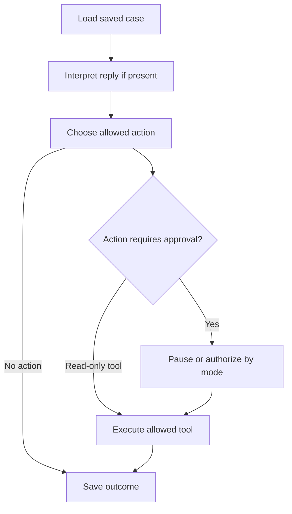

# V2.4 — Durable LangGraph collections cases

This milestone turns the saved conversation into a case workflow. Start performs portfolio analysis, then processes each invoice on the server. The visitor sees collection status, next action and latest completed activity separately. Limited mode pauses consequential actions for approval; autopilot permits bounded actions. Completed processing does not mean every invoice is paid or closed.

Implementation is prepared for review. Charan still merges, applies SQL, deploys and verifies the live result. No live model request, real email or deployment was performed by the assistant.

## 1. Install this milestone

Review and merge the milestone PR, then in the existing VS Code terminal:

```powershell
git switch main
git pull origin main
.\.venv\Scripts\python.exe -m pip install -r requirements.txt
```

Use your existing Python environment if you do not use `.venv`. Do not create another repository or replace your private `.env`.

In Supabase SQL Editor run these complete files, one at a time, in this order:

1. `sql/009_case_workflow.sql` — case workflow, checkpoints, tool receipts and durable jobs.
2. `sql/010_seed_scenarios.sql` — fifteen additional synthetic invoices and their evidence.
3. `sql/011_unlimited_demo_starts.sql` — remove the daily browser/global Start limits. If009/010are already applied, run only011 for this correction.

Earlier SQL001–008 are prerequisites. SQL003 supplies the three preventive invoices. With the original nine plus this seed you get **24 invoices, 21 overdue and 3 preventive, source open balance USD610,400**. These totals assume you have not edited the seed amounts. SQL010 uses insert-on-conflict-do-nothing, so rerunning it preserves source edits; it does not reset conversations, balances or scenarios.

Restart the local backend:

```powershell
.\.venv\Scripts\python.exe -m uvicorn backend.main:app --reload --port 8000
```

For the public site, use the existing Render service and manually deploy the merged commit. It installs the updated requirements. Stop any local backend sharing that same database first: this POC supports one backend process/worker per database. No new account, database password, API key or paid service is needed. Keep existing Groq/Resend configuration. LangGraph runs inside FastAPI and checkpoints through the existing Supabase HTTPS connection; no LangGraph hosted service or LangSmith tracing is used.

If SQL009 is missing, current AR still loads, health reports workflow not ready, and Start explains the setup needed. Do not treat a populated table as proof that graph setup succeeded.

## 2. First hands-on run: limited control

Open the site. Confirm current AR is already visible before Start. Click **Start agent → Limited control**. Watch the portfolio stages and then the selected invoice's case execution in the third column.

Due / aging, Rule urgency and ML risk · target shown remain dedicated columns beside source balance and the three workflow columns. Scroll horizontally inside the invoice panel to see all eight columns; text stays readable. ML labels distinguish becoming overdue from remaining unpaid after30days, and unscored invoices say No matching prediction.

The three workflow columns answer different questions:

| Column | Meaning | Example |
|---|---|---|
| Collection status | Where the case stands now | Awaiting approval |
| Next action | What should happen next | Send reminder |
| Latest activity | What was actually recorded | Reply interpretation saved |

The source balance remains visible independently. A matched demo payment shows a labelled **Demo remaining** amount; it never silently rewrites Supabase source AR.

Choose an eligible overdue case with a draft. Its **Send email** button approves the pending graph action and invokes the existing real Resend tool. The server chooses the fixed project test inbox, draft and idempotency key. The visitor cannot supply an arbitrary destination. Accepted by Resend is distinct from delivered; a verified signed webhook updates the displayed delivery evidence.

Type a customer reply and click **Send simulated reply**. This saves a website event and resumes the case automatically; it is not a received external email. **Use suggested scenario reply** only fills the composer, so you can read or edit it before submitting. There is no separate Save/classify step.

## 3. Scenario exercises

These new records use controlled synthetic evidence attached to that invoice. No real ERP, bank account, purchase-order service or document provider is connected.

| Invoice | Scenario | Expected case behavior after its suggested reply |
|---|---|---|
| INV-10601 | Clear future promise | Limited mode requests approval to record; autopilot records the validated promise and check-after date |
| INV-10602 | Previously missed promise | Start checks demo payment evidence and records follow-up due |
| INV-10603 | Ambiguous promise | Ask for a specific supported future date; no invented commitment |
| INV-10604 | Price discrepancy | Hold collection, retrieve invoice/PO evidence, show USD2,000 difference |
| INV-10605 | Quantity discrepancy | Hold collection, retrieve invoice/POD evidence, show USD1,450 difference |
| INV-10606 | Missing proof of delivery | Hold and identify missing POD |
| INV-10607 | Full demo payment | Match exact posted invoice/currency evidence; Demo remaining USD0 |
| INV-10608 | Partial demo payment | Match USD5,000; Demo remaining USD15,000 |
| INV-10609 | Unmatched payment claim | Keep USD8,500 open in demo view; request matching evidence |
| INV-10610 | Invoice-copy request | Retrieve controlled invoice copy for review |
| INV-10611 | PO request | Retrieve available controlled invoice/PO documents |
| INV-10612 | POD request | Retrieve available controlled invoice/POD documents |
| INV-10613 | Missing contact | Stop outreach and request contact verification |
| INV-10614 | Prior bounce scenario | Show simulated delivery exception; no automatic new reminder |
| INV-10615 | Prior unknown-send scenario | Show simulated prior uncertainty; no automatic new reminder |

Dispute/document tools retrieve evidence for review; they do not automatically send attachments or issue credit notes. Price/quantity differences are computed in Python, not accepted as arithmetic from the LLM. A payment claim triggers matching against the synthetic posted ledger, not an automatic Paid status.

The source snapshot date is 2026-10-17. The clear promise example uses 2026-10-24, with a check-after date of 2026-10-25. This is simulation time, separate from real UTC quota dates and email timestamps. Recording a date does not create an always-on scheduler. A demo-clock UI and automated later follow-up execution remain future work.

## 4. Autopilot exercise

Autopilot applies to **new cases** created by that job. It can send at most **three newly eligible reminders per run**, within the existing ten global daily email reservations. Further eligible sends pause for approval. Clear supported promises can be recorded automatically; disputes, ambiguity and missing evidence remain visible review states.

Existing cases preserve their original mode, conversation and send history. Starting another run is not a reset and does not upgrade old limited cases to autopilot or resend accepted email. To see the initial autopilot experience, use a fresh browser session while remembering all visitors still share global quotas and the fixed test inbox. Do not clear database history to force the demonstration.

The job is planned before portfolio analysis starts and activated on the server after analysis succeeds. It does not depend on an open SSE connection. Closing the page does not stop a healthy running backend; stopping/redeploying the backend interrupts it. After restart, refresh and use **Resume saved case processing**, or the affected case's resume/approval control. Saved automatic-send slots are retained across job retries. Existing waiting approvals stay waiting.

## 5. Understand the code



| File | Responsibility |
|---|---|
| `backend/workflow/agent.py` | Actual StateGraph nodes, routing, approval interrupts, resume, financial/evidence tools and case jobs |
| `backend/workflow/checkpoints.py` | Async LangGraph saver over Supabase RPC; checkpoint values, metadata, parent and pending writes |
| `backend/main.py` | Start/mode, job status, case approval/resume endpoints; constructs shared services |
| `backend/runner.py` | Existing finance pipeline and server-side continuation into case processing |
| `backend/cases.py` | Save/deduplicate the simulated reply before graph/model processing |
| `backend/language.py` and `backend/llm/` | Existing modular provider, strict structured reply validation and free-only budgets |
| `backend/mail/` | Existing real email, idempotency, quotas and signed delivery handling |
| `sql/009_case_workflow.sql` | Durable checkpoint/job/effect storage and service-only RPCs |
| `sql/010_seed_scenarios.sql` | Additive synthetic invoices, documents and ledger evidence |
| `dist/workflow-ui.js` | Case state, execution trace, mode dialog and polling presentation |
| `dist/app.js` | Existing portfolio/run/conversation UI, now using separate outcome columns |
| `tests/test_case_agent.py` | Real graph and SQL integration with mocked external providers |

Trace one promise: reply POST → save UUID/text → graph load → claim one model attempt → structured interpretation and literal evidence validation → choose record_promise → limited-mode interrupt → approve using current event key → record promise/check-after date → finish. Reload reads saved state. No browser timer manufactures completed actions.

The LLM interprets language and optionally drafts reminders. Deterministic policy chooses from allowed tools, checks mode, validates dates, computes financial amounts and controls sending. This is a bounded case agent, not an unrestricted LLM deciding destinations, payments or code to execute. LangGraph uses durable `interrupt()` and `Command(resume=...)`; approval nodes may replay, so irreversible work occurs only after authorization and uses stored tool/idempotency receipts.

References: [LangGraph interrupts](https://docs.langchain.com/oss/python/langgraph/interrupts) and [persistence](https://docs.langchain.com/oss/python/langgraph/persistence).

## 6. Boundaries and troubleshooting

- The existing free-only Groq configuration remains optional. Disabled, invalid, failed or quota-capped model output becomes manual review, never fabricated success. A typical run uses up to four draft attempts, leaving up to four reply attempts within the existing eight-per-browser UTC daily limit. Global limit remains forty; the process limit also applies. Testing every scenario live in one day is not promised.
- Ten global email reservations per UTC day remain durable. A quota-limited case shows a wait state while other cases continue. Retry is explicit after the budget is available. Uncertain send outcomes are never blindly retried; existing stored payload/idempotency and stale-unknown protections remain.
- Real inbound replies still use the existing private review flow. This graph milestone automatically processes the explicitly simulated website reply channel; it does not expose the private Resend inbox to visitors.
- Each browser owns its case/job/checkpoint access. SQL tables/RPCs are service-only; secrets stay on the server. Public visitor isolation uses the existing signed cookie, not an email-owner token.
- Checkpoints retain the latest eight per case/namespace, activity the latest forty entries, and reply history the existing twelve-per-case cap. Browser case capacity is now thirty-two (global five hundred), enough for this portfolio. This is bounded resume storage, not an unlimited time-travel archive.
- Supabase/Render free services can pause or sleep. Resume is explicit after a backend restart; no always-on or exact-time follow-up promise. Keep one backend worker and avoid redeploying during a run.
- If a model attempt was reserved but its result was lost, resume falls back to manual review instead of calling the model twice. If a reply was saved before its first graph checkpoint, resume can pick it up. A stale approval cannot authorize a newer reply.
- UI execution displays recorded action/evidence summaries, never private model reasoning. The two ML models and their synthetic training limitations remain unchanged.

## 7. Explain it in an interview

“I built a live AR collections POC with two risk models and a durable LangGraph case workflow. It separates planned actions from recorded outcomes, supports approval and bounded automatic execution, sends real test emails through Resend, and processes simulated customer replies against controlled invoice, document and payment evidence. Supabase stores cases, checkpoints and audit records. Payment claims cannot change source balances, and restarts do not cause blind resends.”

Do not claim a production ERP connector, bank reconciliation, attachment automation, live voice calls or unattended scheduling. Those are future extensions.

Your exercise: open `choose()` in `agent.py`, find why a missing contact prevents sending, then trace a full-payment claim through `interpret()`, `choose()` and `match()`. Explain why source balance stays unchanged even when Demo remaining becomes zero.

Next milestone, after this live acceptance: improve the demo clock/due-task experience and guided scenario selection, then consider the visitor data editor. Voice/IVR remains optional and deferred until a zero-cost route is established.

## Implementation verification

135 automated tests passed with real LangGraph and isolated Postgres-compatible PGlite SQL; model and Resend transports were mocked. Both limited and autopilot local HTTP/SSE/JSDOM flows passed:24records, separate columns, mode choice, send/delivery, simulated reply matching, promise approval/automatic recording, reload and unchanged sourceAR. JavaScript syntax passed. These checks do not verify live external providers or pixel/viewport layout.

To run the automated suite locally, install Node test dependencies once (`npm install --prefix tests`), then install `requirements-dev.txt` in your Python environment and run `python -m pytest -q`. Tests never need live keys.

## If Resend says live email is disabled

`{"detail":"Live email is disabled. No email attempted."}` comes from the app's email enablement check. The webhook request reached the application but was rejected before signature/event processing. It is not a successful webhook receipt.

In your existing Render service → Environment, set `EMAIL_ENABLED=true`. Preserve `RESEND_API_KEY`, `RESEND_WEBHOOK_SECRET` for that exact Resend endpoint, `EMAIL_FROM`, `EMAIL_TEST_RECIPIENT` and `EMAIL_RECEIVING_DOMAIN`. Keep secrets private. Save/redeploy and wait for the new process to become live. Check `/api/health`: expect `email.enabled` and `email.ready` both true; otherwise follow `email.configuration_error`. The repository's render.yaml defaults false intentionally; editing a local .env does not change cloud settings.

In Resend replay one failed sent/delivered event against `https://YOUR-ACTUAL-HOST/api/webhooks/resend`, then inspect the response and matching saved activity. A received event should appear in the private inbound review flow. Do not resend the original email to repair a callback. A reachable GET proves routing only; a signed POST and matching stored evidence prove processing. Live confirmation requires the actual website URL and event outcome.

## Remove the daily Start limits (SQL011)

The daily three-per-browser and twenty-global run limits are removed at Charan's request. After merging this update, pull main, run the complete `sql/011_unlimited_demo_starts.sql` in Supabase SQL Editor, then manually deploy the existing Render service. No new package or environment variable. Do not set PUBLIC_DEMO=false: signed browser isolation and private data filtering stay enabled.

SQL011 is additive and safe to rerun. Existing runs, cases, conversations and usage records are preserved. Old daily run counters no longer block Start and new Starts no longer consume them. `/api/health` should report `public_demo.daily_run_limit_enabled:false`, `daily_run_cap:null` and `per_browser_runs:null`. Before migration, health/UI honestly show that daily Start limits remain active.

The real-email allowance (ten new reservations/day), free-only model budgets and per-job three automatic reminders remain. Model exhaustion falls back to templates/manual review instead of blocking portfolio analysis. Repeated Starts reuse saved cases and do not resend accepted emails or reset case mode. Existing storage/reply capacities and the five-simultaneous-analysis server guard remain separate from daily Start limits; their messages distinguish them from daily run quotas.

Live site: https://o2c-collections-agent.onrender.com/. Read-only check before this update confirmed24invoices, LangGraphready, emailenabled/ready and reachable webhookGET; LLMdisabled/templateonly. This is not a signed callback delivery check. Assistant did not deploy SQL011 or trigger a live run/provider call.
