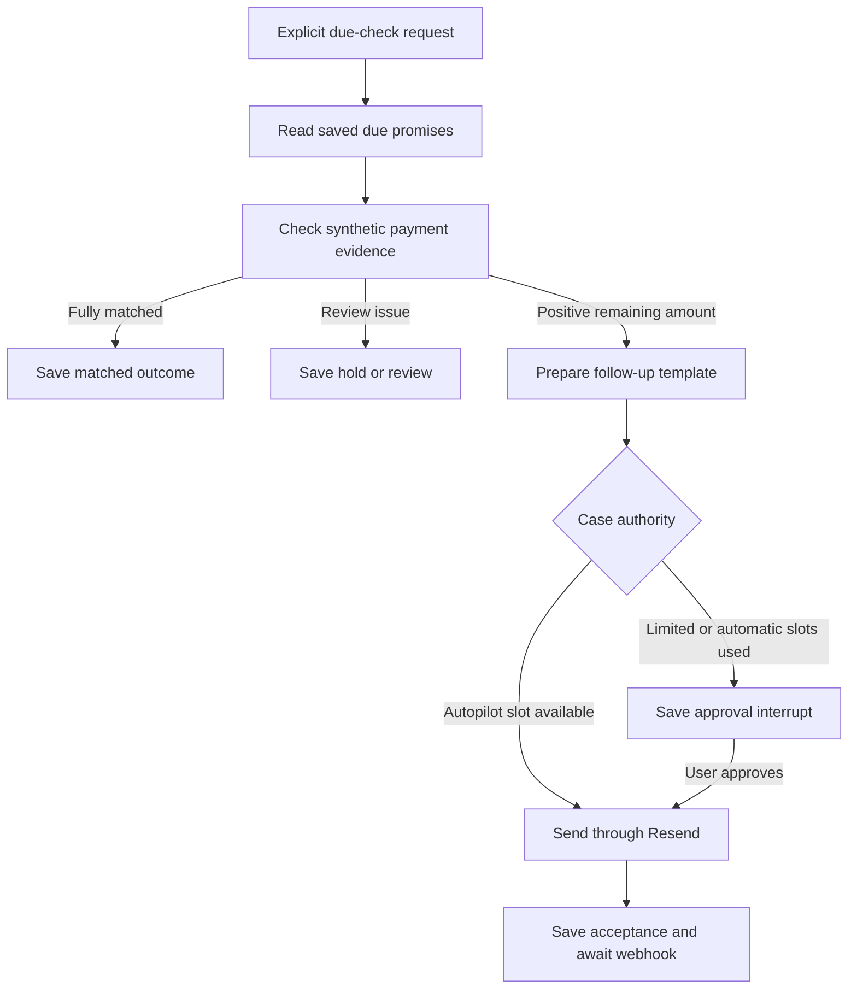

# V2.5 — Promise checks, follow-up emails and a bounded workspace

This milestone connects a saved payment promise to an explicit future-date check. It checks controlled payment evidence before preparing a reminder, respects each case's original limited/autopilot mode, saves outcomes and sends an authorized follow-up through Resend. It also fixes the tall invoice table and inconsistent column scrolling.

Implementation is prepared for review. Charan applies the migration and deploys; learner/live acceptance is still pending. No live email, model call, Supabase mutation or deployment was performed by the assistant.

## Apply this milestone

1. Review/merge the PR and pull main in your existing VS Code project:

   ```powershell
   git switch main
   git pull origin main
   ```

2. In Supabase SQL Editor, run the complete `sql/012_promise_followups.sql`. Earlier SQL001–011 are prerequisites. This is additive and safe to rerun; source invoices, existing cases, messages, sends and usage history remain. Do not rerun old migrations after newer ones out of order.
3. Restart your existing local backend, or manually deploy the latest merged commit on the existing Render service. Keep one backend process per database. No new package, API key, paid account or environment variable.
4. Check `/api/health`: `followups.ready` should be true, schema12. The existing graph/source still works without012, but the simulator explains that012 is required. Existing SQL011 still removes daily Start quotas.

## See the new UI

The three desktop columns now share a bounded workspace height and move together with the page. The AR table, customer/email stack and execution panel each scroll their own content; the execution column no longer sticks while the customer panel scrolls away. At narrower widths the layout remains two/one columns with bounded panels.

The table header stays visible during vertical table scrolling. Above the table, a persistent horizontal navigation strip has left/right buttons and a position slider. It exposes all eight existing columns without relying on an operating system's disappearing scrollbar. Text size remains readable; no risk, aging or workflow field was removed.

Select a row, scroll down inside the invoice table, then scroll the customer stack and execution panel separately. Move the slider right to inspect Latest activity; move it left to return to Customer/invoice. The navigation stays above the table body rather than disappearing after its last row.

## Exercise A — Works without an LLM

After Start completes, select **INV-10602 · Granite**. Its synthetic scenario already includes a promise for2026-10-14. The source/demo date begins2026-10-17, so that promise is already due.

1. Click **Check due follow-ups**. No calendar advance is necessary for this seeded example.
2. Watch the saved case trace: load → choose payment check → execute synthetic matching → plan follow-up → approval or send → finish.
3. In limited mode, inspect the new **Follow-up reminder** in the customer panel and click **Send follow-up**. Autopilot can authorize it automatically if this check has an available automatic slot.
4. Inspect the Resend acceptance status, then its verified delivery webhook update. Acceptance alone is not delivery or payment.
5. Click Check again. The same promise does not generate a second email. The previous send remains in Follow-up email history.

Email must be enabled/configured for real sending. Otherwise the case explains the configuration issue; after fixing it, an explicit reviewed follow-up retry is available. No arbitrary recipient/body is accepted from the visitor. All emails go to the existing fixed project test inbox.

## Exercise B — A newly recorded promise

Enable the existing free-only Groq configuration if you want the model to interpret typed replies. Without a valid enabled model, new replies remain manual-review inputs; this milestone does not fabricate a promise.

1. Start in limited mode and select **INV-10601**.
2. Submit the scenario's supported promise: payment on2026-10-24. Approve recording it if requested.
3. Confirm Promise date2026-10-24 and check-after2026-10-25 are saved.
4. Click **Advance7days** to move from2026-10-17 to2026-10-24. Check due follow-ups. This promise is not due yet.
5. Set Demo date to2026-10-25 and click **Save demo date**. Changing the date alone sends nothing.
6. Click **Check due follow-ups**. With no matching payment evidence, the graph prepares a follow-up forUSD12,000. Limited mode waits for Send follow-up.
7. Send it, inspect the real delivery status and reload. The date, case, draft, send record and job outcome remain saved.

The clock is per browser session, moves forward only, and is limited to one year after its base snapshot. It does not change source AR aging, trained-model inputs, real provider timestamps or real UTC quotas. Finish/resume active or interrupted due checks before advancing again, so each saved check has one consistent simulation date.

Existing cases keep their original mode and history. Selecting autopilot on a later Start does not change an old limited case. A new browser has separate cases/date, while global model/mail budgets are still shared.

## Other outcomes

| Scenario after a supported promise | Due-check behavior |
|---|---|
| INV-10607 full synthetic payment | Show Payment matched · demo; no follow-up draft or email |
| INV-10608 partial payment | MatchUSD5,000; draft only for demo remainingUSD15,000 |
| INV-10609 unmatched claim | Keep demo remainingUSD8,500; request confirmation/remittance in follow-up |
| New dispute | Hold collection; no follow-up send |
| New unsupported/customer reply | Supersede unsent follow-up and require review |
| Missing contact, prior delivery issue or overpayment | Stop for review rather than chasing |
| Model unavailable | No invented newly recorded promise; the seeded historical promise still demonstrates deterministic checking |

Full/partial matching uses only the controlled synthetic ledger. Source AR is never marked paid or reduced. A customer claim is not payment proof. Document retrieval and price/quantity checks remain available from V2.4; this milestone does not email attachments or resolve disputes automatically.

## Exactly what runs



There is no always-on scheduler. Save demo date only stores time; Check due follow-ups triggers a backend job. The job continues independently of the browser while the backend remains healthy. After restart it is marked interrupted, and **Resume interrupted check** continues stored work. While a check is interrupted, resume it before starting another check or advancing the clock. This preserves its date and automatic-send allocations.

Each check allows up to three automatic follow-up allocations under existing case modes. Remaining sends pause for approval. The existing global ten daily real-email reservations and free-only model budgets remain. Unknown send outcomes have no automatic retry; explicit retries reuse the stored payload/idempotency key and existing twenty-hour unresolved-intent protection. Replaying a webhook is different from resending email.

Follow-up drafts use deterministic Python templates populated with the validated promise and Decimal-computed demo remaining amount. Due checking does not call an LLM. Existing LLM calls remain reminder drafting and reply interpretation.

## Storage and code map

| File/table | Purpose |
|---|---|
| `backend/workflow/followups.py` | Select owned due cases, save job progress/automatic slots, invoke/resume case graphs |
| `backend/workflow/agent.py` | Due routing, matching, new plan_followup node, approval, real follow-up tool and retry |
| `backend/mail/service.py` | Fixed-recipient follow-up send using stable stored intent and existing Resend adapter |
| `backend/main.py` | Demo-clock, due-job and follow-up-send routes; schema readiness |
| `sql/012_promise_followups.sql` | Additive migration, service-only RPCs, projection and restart recovery |
| `ca_demo_clocks` | Browser-owned base date and current simulation date |
| `ca_due_jobs` | Durable date/case list, progress, automatic slots and interrupted/completed state |
| `ca_collection_cases.workflow` | Promise/event key, demo date, matching outcome and current follow-up draft/status |
| `ca_case_followup_mail` | Link a case/promise event to exactly one follow-up intent |
| `ca_mail_messages.purpose_key` | Distinguish initial reminder from follow-ups without deleting initial history |
| `dist/followup-ui.js` | Date/check controls, job presentation and horizontal table navigation |
| `dist/styles.css` | Bounded aligned panels, internal scrolling, sticky table headers and visible navigation |
| `tests/test_promise_followups.py` | Real graph/SQL, mocked model and Resend regression scenarios |

A promise's event key identifies its due check. New requests for the same promise reuse the saved case workflow instead of producing another send. A new supported promise has a new event key. Stale approvals cannot authorize a newer reply. Supabase stores business facts separately from LangGraph checkpoints and tool receipts, including recovery if a business draft was saved just before its node checkpoint failed.

API routes: GET/POST `/api/demo-clock`; POST `/api/followup-checks` with a request UUID; GET latest/job-specific check; POST job-specific resume; POST `/api/cases/{id}/followup-email` with no body/recipient overrides. All access is browser-owned, including local mode. Keys/private inbox content remain server-side.

Exercise: find `plan_followup()` and explain why a full payment returns no action. Then find `send_followup()` and explain why a second due check cannot create a new intent for the same promise.

Next, after live acceptance: guided interviewer walkthrough, then visitor data editing last. A real unattended scheduler and real bank/ERP reconciliation would be separate future work.

## Implementation verification

154 regression tests passed with real LangGraph and isolated PGlite/Postgres SQL. After final refinements, all15follow-up integration tests passed again. Provider transports were mocked; no live email/model account was used. Tests include repeated checks, full/partial/unmatched evidence, approvals/modes, automatic allocation limits, stale replies, quotas, unknown outcomes, browser isolation, additive migration and recovery after persistence failures.

Local HTTP/SSE/cookie-aware JSDOM verification passed the promise/date/check/approval/send/signed-delivery/reload flow, all eight columns, nonsticky execution/customer scrolling styles, and horizontal arrow/slider behavior using simulated scroll dimensions. JavaScript syntax and Python compilation passed. A real browser pixel/viewport screenshot check was unavailable; these checks are not live deployment/provider acceptance.
